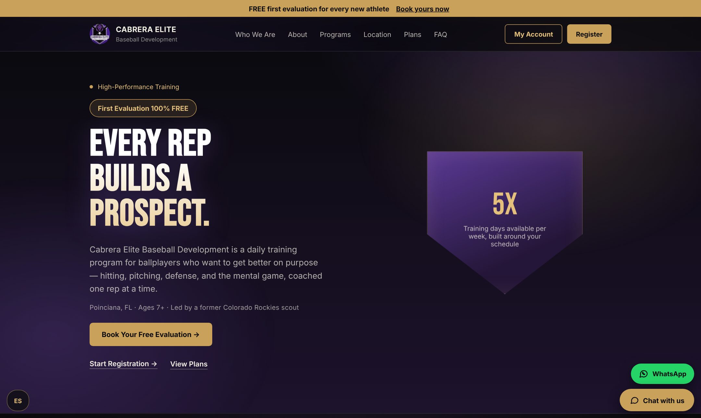
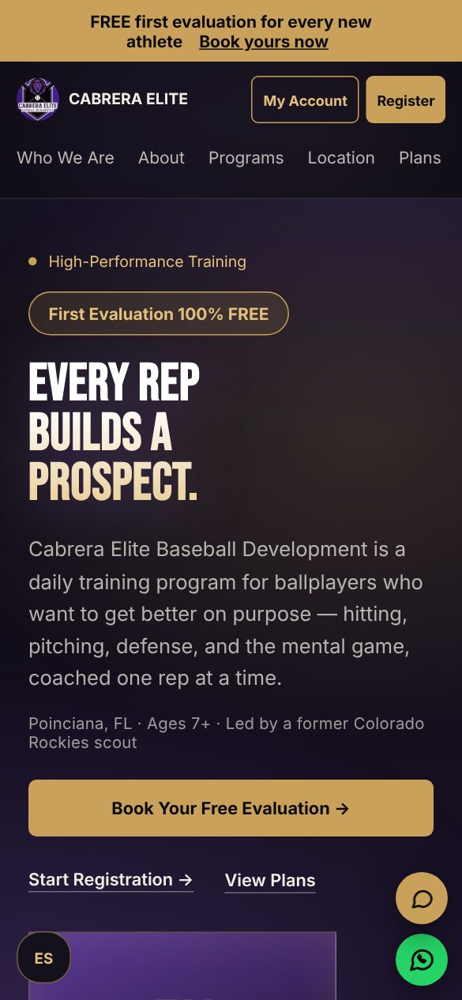
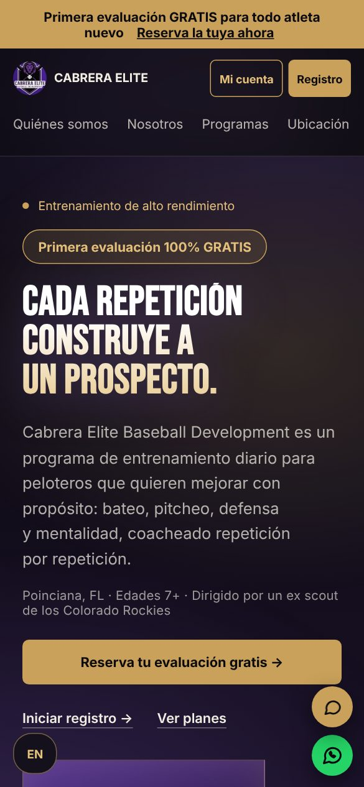
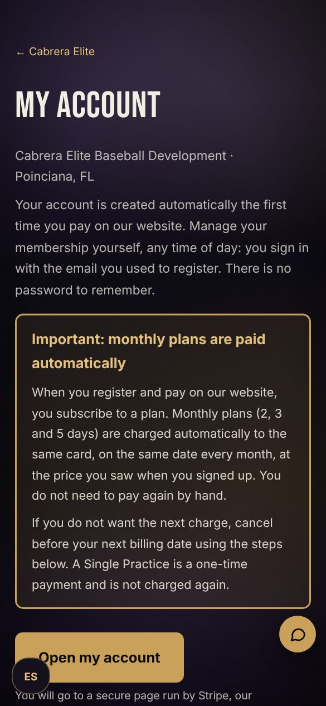
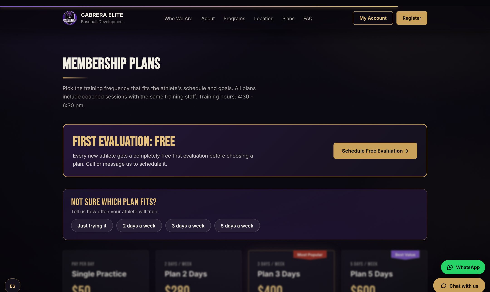
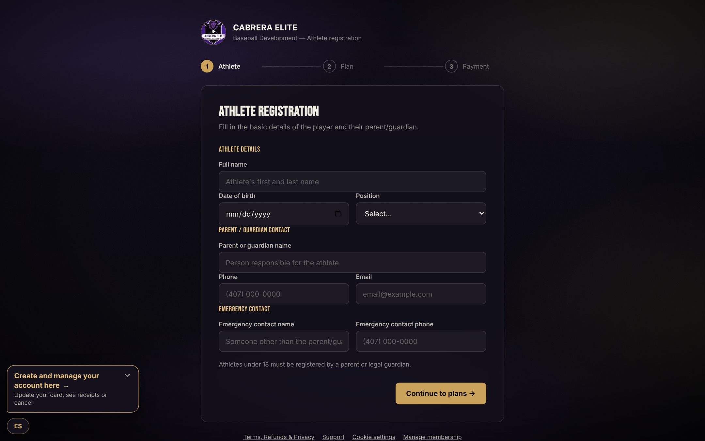
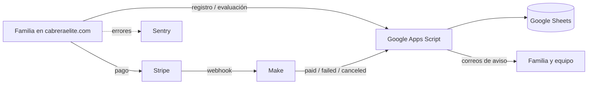

<div align="center">


# Cabrera Elite Baseball Development

**Programa de entrenamiento diario de béisbol en Poinciana, FL — sitio web, registro de atletas y pagos.**

[](https://cabreraelite.com)
[](https://pages.github.com)
[](https://www.cloudflare.com)
[](https://stripe.com)
[](#)



</div>

## Contenido

- [Vista previa](#vista-previa)
- [Qué hace el sitio](#qué-hace-el-sitio)
- [Tecnologías](#tecnologías)
- [Cómo funciona](#cómo-funciona)
- [1. Google Apps Script](#1-google-apps-script-codegs)
- [2. Stripe](#2-stripe)
- [3. Make](#3-make-escenario-stripe--sheets)
- [4. Versiones de documentos legales](#4-versiones-de-documentos-legales)
- [5. Revisión final antes de cobrar](#5-revisión-final-antes-de-cobrar-verificado-en-stripe-el-2026-10-10)

## Vista previa

| Celular (EN) | Celular (ES) | Mi cuenta |
|:---:|:---:|:---:|
|  |  |  |

| Planes y selector «¿Qué plan me conviene?» | Registro (paso 1 de 3) |
|:---:|:---:|
|  |  |

> Las capturas muestran solo la interfaz; no incluyen fotos de atletas ni datos de familias.

## Qué hace el sitio

| Función | Cómo funciona | Archivos |
|---|---|---|
| **Portada orientada a conversión** | Un botón principal («Book Your Free Evaluation») y dos enlaces secundarios (registro y planes); barra de promoción y barra de confianza. | `index.html` |
| **Evaluación gratis con waiver** | Formulario con firma, verificación anti-bot (Turnstile) y envío a Google Sheets; lo que falla la verificación queda en la hoja «Cuarentena». | `index.html`, `antibot.js`, `Code.gs` |
| **Registro en 3 pasos** | Atleta → plan → pago en Stripe con referencia `CE-…` para conciliar el pago. | `register.html` |
| **Selector de plan** | Botones por frecuencia semanal que señalan el plan correcto y abren el registro con ese plan preseleccionado. No cobra ni guarda datos. | `plan-finder.js` |
| **Mi cuenta / portal del cliente** | Guía paso a paso y acceso al portal de Stripe (tarjeta, facturas, cancelación al final del mes pagado). El globo flotante lleva a esta página. | `account.html`, `account-bubble.js` |
| **Chat con IA** | Worker de Cloudflare con Workers AI, límite por visitante y verificación Turnstile; si se agota la cuota muestra teléfono y correo. | `chat.js`, `chat-worker/` |
| **Español e inglés** | Diccionario en `lang.js`; `tools/build_site.py` genera `es/` y el sitemap con `hreflang`. | `lang.js`, `tools/build_site.py` |
| **Contenido opcional** | Video con avance, horario, reservas, tienda, testimonios y galería aparecen solo si se llenan en `site-config.js`. | `site-config.js`, `extras.js` |
| **Animación sutil** | Revelado al desplazarse, contadores y paralaje; respeta `prefers-reduced-motion`. | `fx.js`, `bg.css` |
| **Privacidad y cookies** | Google Analytics solo se carga tras aceptar cookies. Sentry sin datos personales. | `cookies.js`, `track.js`, `sentry-init.js` |
| **SEO y descubrimiento** | `sitemap.xml`, `robots.txt`, JSON-LD, `llms.txt`, Open Graph y PWA manifest. | `sitemap.xml`, `llms.txt`, `manifest.webmanifest` |
| **Seguridad** | CSP en cada página, cabeceras en Cloudflare (ver `docs/CABECERAS_CLOUDFLARE.md`), `tools/check_headers.sh` para comprobarlas. | `docs/`, `tools/` |

> Los precios, el waiver y los textos legales están definidos por el negocio; este README los documenta, no los define.

## Tecnologías

| Área | Qué se usa |
|---|---|
| Sitio | HTML, CSS y JavaScript estáticos, bilingüe EN/ES (`es/` se genera con `tools/build_site.py`) |
| Hosting | GitHub Pages con dominio propio |
| Seguridad | Cloudflare (DNS, HTTPS, HSTS, Turnstile, límites por IP), CSP en cada página |
| Pagos | Stripe Checkout / Payment Links y Portal del cliente |
| Automatización | Make (webhook de Stripe) → Google Apps Script → Google Sheets |
| Chat | Cloudflare Worker con Workers AI (`chat-worker/`) |
| Monitoreo | Sentry (errores y disponibilidad) con `sentry-init.js`, sin cookies ni datos personales |

## Cómo funciona



### Detalle

```
Web (index.html / register.html)
   │  POST (formulario)
   ▼
Google Apps Script  (Code.gs)  ──►  Google Sheets
   ▲                                  • 1ª hoja: registros de atletas (estado: Pendiente → Pagado…)
   │  POST (evento: paid|failed|canceled)  • "Evaluaciones": solicitudes de evaluación gratis
Make  ◄── eventos de Stripe             • "Pagos sin registro": pagos que no coincidieron con ninguna fila
```

| Archivo | Qué es |
|---|---|
| `index.html` | Página principal + formulario de evaluación gratis (con waiver y firma) |
| `register.html` | Registro en 3 pasos (atleta → plan → pago en Stripe) |
| `waiver.html` | Página para firmar el waiver (solo con enlace personal con token; no está enlazada desde la web) |
| `terms.html` | Términos, reembolsos, exención, privacidad y uso de imagen (EN/ES) |
| `lang.js` | Cambio EN/ES y traducciones |
| `support.html` | Página de soporte (correos, teléfono, portal del cliente) EN/ES; es la URL de soporte de Stripe |
| `robots.txt`, `sitemap.xml` | SEO básico (subir a la raíz del repo) |
| `GUIA_SITIO.md` | Guía en español: seguridad, video, tienda, calendario, correo y cómo mantener el sitio |
| `tools/build_site.py` | Genera las páginas en español (`es/`), el sitemap y los bloques de seguridad |
| `sentry-init.js` | Reporta errores del sitio a Sentry (sin datos personales) |
| `site-config.js` | Único archivo que se edita para video, horario, reservas, tienda, testimonios, etc. |
| `plan-finder.js`, `fx.js`, `extras.js`, `chat.js`, `cookies.js`, `track.js`, `antibot.js`, `account-bubble.js` | Scripts de interfaz y servicios (ver «Qué hace el sitio») |
| `chat-worker/` | Worker de Cloudflare del chat (`LEEME.md` explica cómo moverlo o actualizarlo) |
| `docs/` | Cabeceras de seguridad de Cloudflare y capturas de este README |
| `Code.gs` | **No se sube a GitHub.** Se pega en Google Apps Script (ver abajo) |

## 1. Google Apps Script (`Code.gs`)

1. En el Google Sheet: **Extensiones → Apps Script**. Pega todo `Code.gs` y guarda.
2. Elige la función **`setupAll`** en el desplegable y pulsa **Ejecutar** (acepta los permisos).
   - Crea/completa encabezados, listas desplegables de estado y la hoja "Evaluaciones".
   - Genera la **clave secreta para Make**: mírala en **Ver → Registros de ejecución** (`WEBHOOK_SECRET ...`). Cópiala.
3. **Implementar → Administrar implementaciones → ✏️ Editar → Versión: Nueva versión → Implementar.**
   Ejecutar como **Yo**, acceso **Cualquier persona**. La URL `/exec` no cambia.
4. Cada vez que cambies `Code.gs` repite el paso 3.

La zona horaria está fija en `America/New_York` dentro del código (constante `TZ`).

### Seguridad de la clave (`WEBHOOK_SECRET`)
- La genera `setupAll` (o `setupWebhookSecret`) y vive en *Propiedades del script* de Google, **no** en el código ni en GitHub.
- Solo se muestra en **Ver → Registros de ejecución** de tu cuenta. Pégala en Make (campo `secret`) y no la compartas con nadie (tampoco en chats).
- Si sospechas que se filtró: ejecuta **`rotateWebhookSecret`**, copia la nueva y actualízala en Make. La anterior deja de funcionar.
- Sin la clave correcta, el script responde `unauthorized` y no cambia nada.

### Evaluaciones ya recibidas sin waiver
1. Haz el deploy y sube `waiver.html` a GitHub.
2. Ejecuta **`verWaiverPendientes`** y mira el resultado en *Ver → Registros de ejecución* (no envía nada ni cambia la hoja).
3. Ejecuta **`pedirWaiverPendientes`**: marca esas filas como `Pendiente` (se ven en rojo claro) y envía a cada familia un correo con su enlace personal. Se envía una sola vez por familia.
4. Cuando firman, la fila pasa a `Yes` y te llega un correo "Waiver firmado". Hasta entonces, ese atleta no debe participar en la evaluación.
- Cuota de correo de Gmail: unos 100 destinatarios por día en cuentas gratuitas.

### Estados de pago (columna `estado`)
`Pendiente` (al registrarse) → `Pagado` · `Fallido` · `Cancelado` (los cambia Make).
Columnas extra que llena Make: `fecha_pago`, `stripe_customer_id`, `stripe_subscription_id`, `ultimo_evento`, `ultimo_evento_fecha`.

### Estados de evaluación (hoja "Evaluaciones", columna `Estado`)
`Nuevo` → `Contactado` → `Agendada` → `Asistió` → `Se inscribió` (o `No respondió`).

## 2. Stripe

### Redirección después del pago (en CADA Payment Link)
Stripe → Payment Links → editar el link → **Después del pago → No mostrar página de confirmación → Redirigir a tu sitio web** y usa:

| Plan | URL de redirección |
|---|---|
| Single Practice | `https://cabreraelite.com/register.html?pago=ok&plan=Single%20Practice` |
| Plan 2 Days | `https://cabreraelite.com/register.html?pago=ok&plan=Plan%202%20Days` |
| Plan 3 Days | `https://cabreraelite.com/register.html?pago=ok&plan=Plan%203%20Days` |
| Plan 5 Days | `https://cabreraelite.com/register.html?pago=ok&plan=Plan%205%20Days` |

### Otros ajustes a verificar
- **Portal del cliente** activado y con cancelación permitida (los términos lo prometen). Su enlace está en `lang.js` (`CE_PORTAL_URL`).
- **Stripe Tax / impuestos**: confirmar con el contador si aplica.
- Los Payment Links reciben `client_reference_id` (la referencia `CE-...`) desde `register.html`; así Make sabe a qué fila corresponde el pago.

## 3. Make (escenario "Stripe → Sheets")

**Módulo 1 – Stripe → Watch Events.** (Make lo expone como `event_type`, `event_id` y `object.*`, no como `type`/`data.object`.) Eventos: `checkout.session.completed`, `invoice.paid`, `invoice.payment_failed`, `customer.subscription.deleted`.

**Módulo 2 – Router con 4 rutas** (cada una con su filtro) y, en cada ruta, un módulo **HTTP → Make a request**:

| Ruta | Filtro | `evento` | `referencia` | `stripe_subscription_id` | `stripe_customer_id` | `email` |
|---|---|---|---|---|---|---|
| Primer pago | `event_type` = `checkout.session.completed` **y** `object.payment_status` = `paid` | `paid` | `object.client_reference_id` | `object.subscription` | `object.customer` | `object.customer_details.email` |
| Renovación | `event_type` = `invoice.paid` **y** `object.billing_reason` = `subscription_cycle` | `paid` | *(vacío)* | `object.subscription` | `object.customer` | `object.customer_email` |
| Pago fallido | `event_type` = `invoice.payment_failed` | `failed` | *(vacío)* | `object.subscription` | `object.customer` | `object.customer_email` |
| Cancelación | `event_type` = `customer.subscription.deleted` | `canceled` | *(vacío)* | `object.id` | `object.customer` | *(vacío)* |
| Cambio de plan *(solo si activas "Switch plan" en el portal)* | `event_type` = `customer.subscription.updated` **y** `raw.data.previous_attributes.items` *Exists* | `plan_changed` | *(vacío)* | `object.id` | `object.customer` | *(vacío)* + campo extra `monto` = `object.items.data[].price.unit_amount` (el precio del plan nuevo, en centavos, p. ej. 40000) |

Con "cancelar al final del período", cuando el cliente cancela en el portal Stripe solo programa la cancelación (`customer.subscription.updated`). La hoja pasa a `Cancelado` al terminar el mes pagado (`customer.subscription.deleted`), que es lo que prometen los términos. Para agregar la ruta de cambio de plan en Stripe Watch Events, incluye también el evento `customer.subscription.updated`.

Configuración del módulo HTTP (igual en las 4 rutas):
- **URL**: la URL `/exec` del Apps Script (la misma de `register.html`).
- **Method**: `POST` · **Body type**: `application/x-www-form-urlencoded` · **Follow redirect**: sí (por defecto).
- **Fields** (además de los de la tabla): `secret` = la clave de `setupAll`, y `event_id` = `event_id` (el id del evento de Stripe, módulo 1) (evita avisos duplicados).
- Si en tu versión de la API de Stripe `object.subscription` viene vacío en las facturas, usa `object.parent.subscription_details.subscription`.

### Respuestas del script
`ok` actualizado · `duplicate` evento repetido · `not_found` no hay fila (el pago queda en la hoja **"Pagos sin registro"** y llega un correo) · `unauthorized` clave incorrecta · `error: ...`.

### Probar sin pagar
```bash
curl -L -X POST "URL_DEL_SCRIPT" \
  -d "secret=TU_CLAVE" -d "evento=paid" -d "referencia=CE-XXXX-XXXX"
```
(usa una referencia real de una fila de prueba; debe responder `ok` y la fila pasa a `Pagado`).

Cada evento envía un correo de aviso al correo del negocio configurado en el script.

## 4. Versiones de documentos legales
`terms.html`, `register.html`, `index.html` y `waiver.html` comparten la versión (`2026-10-09d`). Si cambias los textos legales, sube la versión en: `terms.html` (2 lugares), `register.html` (`TERMS_VERSION`, `WAIVER_VERSION`, `PRIVACY_VERSION`), `index.html` (`EVAL_WAIVER_V`, `EVAL_PRIVACY_V`) y `waiver.html` (`WAIVER_V`, `PRIVACY_V`).

## 5. Revisión final antes de cobrar (verificado en Stripe el 2026-10-10)
- Payment Links en vivo con precios correctos ($50 / $280 / $400 / $600), redirección `register.html?pago=ok&plan=...` correcta e impuestos automáticos activos.
- Portal del cliente activo: cancelación al final del período y enlace igual al de `lang.js`. "Cambiar de plan" está desactivado, así que la ruta *plan_changed* de Make NO es necesaria.

## 6. Desarrollo local y comprobaciones

```bash
python3 -m http.server 8765        # servir el sitio en http://localhost:8765
python3 tools/build_site.py        # regenerar es/ y sitemap.xml tras cambiar HTML o lang.js
bash tools/check_headers.sh        # revisar cabeceras de seguridad en producción
```

Antes de subir cambios: probar en celular (≈390 px) y escritorio, en EN y ES, con y sin cookies aceptadas, y confirmar que los pagos se verifican en Stripe (no solo en la pantalla del navegador).

## 7. Herramientas de agentes (opcional)

Para trabajar este repo con Claude Code o Codex hay una guía reutilizable en `AGENTS.md` y un instalador de skills de animación y diseño en `SKILLS-INSTALL.md`. El sitio actual no depende de GSAP ni three.js: `fx.js` cubre las animaciones sin dependencias.
